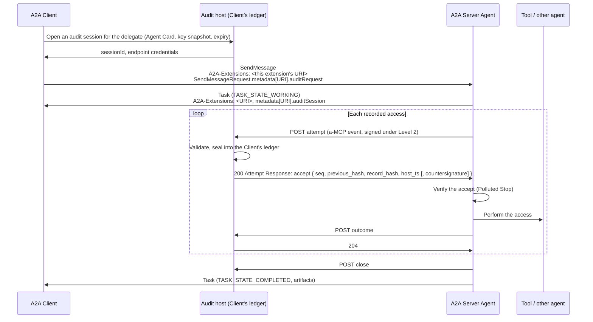

# A2A Protocol Extension: Auditable A2A (v0.1 Draft)

- **URI:** `https://timberlandchapel.com/a2a/extensions/auditable-a2a/0.1`
- **Type:** Profile Extension
- **Version:** `auditable-a2a/0.1` (Draft)
- **Builds on:** Agent2Agent (A2A) Protocol 1.0.0 [A2A]; Auditable MCP `auditable-mcp/0.4` [a-MCP]
- **Author:** [Satoshi Imai](https://github.com/SatoshiImai)

## Abstract

This extension lets an A2A Client require that **no act a Server Agent records on its behalf proceeds unless the act was first recorded in the Client's audit ledger**.

A2A lets an agent complete a task without exposing its internal state, memory, or tools (Opaque Execution). That opacity is what allows independent agents to collaborate. It also means that a Client delegating a task cannot say, of its own records, what was done under its authority. Regulated deployments need to be able to say this: a financial institution, or the provider or deployer of a high-risk AI system under the record-keeping provisions of the EU AI Act.

The extension resolves this without weakening opacity. Before each access outside its model that crosses the boundary the Client trusts, the Server Agent sends an *attempt* to an audit endpoint the Client declared, and acts only after the Client's audit host has sealed the attempt into the Client's ledger and answered with an *accept* the Server Agent has verified. The record names the kind of act, its effects, and its counterparty. The content can stay behind a salted hash. The Client sees that and how the task proceeded; it does not see the Server Agent's reasoning, and it cannot steer it. The audit endpoint rules only on whether a record is valid, never on whether an act may happen.

The audit session lasts exactly as long as the Task, however many days that is, and survives a restart of either side. A Task whose acts can no longer be recorded does not continue.

The record format, its canonicalization, signatures, and ledger chaining are those of Auditable MCP (a-MCP). This extension carries a-MCP's guarantee, "no unrecorded act", from the tool boundary to the delegation boundary.

## 1. Conventions and Terminology

The key words "MUST", "MUST NOT", "REQUIRED", "SHALL", "SHALL NOT", "SHOULD", "SHOULD NOT", "RECOMMENDED", "NOT RECOMMENDED", "MAY", and "OPTIONAL" in this document are to be interpreted as described in BCP 14 [RFC2119] [RFC8174] when, and only when, they appear in all capitals.

Terms of A2A (Client, Server Agent, Task, Message, Agent Card, `metadata`, service parameter, terminal state) have their A2A meaning. Terms of a-MCP (*attempt*, *outcome*, *Attempt Response*, *accept*, *reject*, *unavailable*, *ledger*, *partition*, *anomaly set*, *Polluted Stop*, *countersignature*, *Level 1*, *Level 2*) have their a-MCP meaning. An *audit session* is a-MCP's, extended to last as long as a Task (§5). In a-MCP's roles, the Server Agent is the *tool* and the Client's audit host is the *host*. In addition:

- **Audit host** - The party that seals records into the Client's ledger and answers attempts, in the a-MCP host role. It is a service the Client operates or designates, distinct from the Client's agent runtime.
- **Audit endpoint** - The HTTPS endpoint at which the audit host receives the submissions of one audit session (§6).
- **Model-external access** - An access by the Server Agent, in performing a Task, to something other than the closed, trained model that reasons for it: a local or remote tool call, an MCP `tools/call`, a request to another agent, a read or write of a store, a network request. Calling the reasoning model is not one: the model is part of the Server Agent the Client delegated to, wherever it runs, so calling it is not an access even when it is reached over a network. Whether the Client accepts where the model runs is part of choosing the delegate, not of this extension. Computation inside the Server Agent that reaches nothing outside it is not an access.
- **Recorded access** - A model-external access the Server Agent records under this extension (§8.1).
- **Within a Task** - After the Task is created and before it reaches a terminal state, the lifecycle A2A gives a Task (A2A §3.4.2).
- **Delegate** - The Server Agent a Client delegates an audit-negotiated Task to, as the audit host recorded it when it opened the session (§5.1).
- **Audit-negotiated Task** - A Task for which the conditions of §4.3 held when it was created.
- **Execution report** - A record by which the Server Agent states that it did not perform an accepted access, or does not know whether it did (§8.6).

Structures carried on the A2A wire (Agent Card `params`, `metadata` entries) and at the audit endpoint use A2A's JSON naming (lowerCamelCase). a-MCP objects carried inside them (events, Attempt Responses, countersignature fields) keep a-MCP's names unchanged.

## 2. Overview

The diagram below is a non-normative example of one audit-negotiated Task.



If the audit endpoint cannot record an attempt, the Server Agent does not perform the access. It holds the Task in `TASK_STATE_AUTH_REQUIRED`, annotated through `metadata` (§8.4). The Client cannot see or alter the Server Agent's reasoning. Every access the Server Agent recorded for the Task is in the Client's ledger, and each was recorded there before it happened.

## 3. Agent Card Declaration

A Server Agent that supports this extension **MUST** declare it in its Agent Card under `capabilities.extensions`.

| Field | Value |
| --- | --- |
| `uri` | This extension's URI for the version supported (§4.1). A Server Agent that supports several versions declares one entry per URI. |
| `required` | `true` if the Server Agent does not accept requests that do not activate this extension (the *mandatory* posture, §4.5); otherwise `false`. |
| `params` | The object below. |

### 3.1 `params`

| Field | Type | Required | Description |
| --- | --- | --- | --- |
| `level` | string | Yes | The highest a-MCP conformance level the Server Agent attests at: `"L1"` or `"L2"` (a-MCP §5). |
| `countersign` | string | Yes | `"host"` if the Server Agent requires the audit host to countersign every accept; `"none"` otherwise (a-MCP §5.2, §6.1). |
| `selfChain` | boolean | No | `true` if the Server Agent also chains its own acts into a ledger it keeps (§9.3). Absent means `false`. |
| `attestationKeys` | string | Yes, if `level` is `"L2"` | The `https` URL, without a fragment, of the JWKS [RFC7517] holding the keys the Server Agent signs events with (§10.2). |

A Server Agent that declares `level: "L2"` **MUST** sign its Agent Card (A2A §8.4). The signature binds the agent's identity to `attestationKeys`.

A Server Agent that resumes audit-negotiated Tasks after its own restart (§5.5) **SHOULD** declare `countersign: "host"`. Without a countersignature, the position the audit host reports when the Task resumes (§6.5) is unsigned, and the Server Agent can rely only on the channel that carried it.

#### Example: Agent Card declaration

```json
{
  "uri": "https://timberlandchapel.com/a2a/extensions/auditable-a2a/0.1",
  "description": "Records each access the Client's trust boundary covers in the Client's ledger before it happens",
  "required": true,
  "params": {
    "level": "L2",
    "countersign": "host",
    "selfChain": true,
    "attestationKeys": "https://agent.example.com/.well-known/jwks.json"
  }
}
```

## 4. Activation and Negotiation

### 4.1 Versioning

Each version of this specification has its own URI, and the version is the last path segment (`…/0.1`). A breaking change takes a new URI (A2A §4.6.3). A Client that supports several versions lists each URI in `A2A-Extensions`. A Server Agent **MUST NOT** fall back to a version the Client did not request (A2A §4.6.3).

An audit session is opened for one version, and follows that version's rules from its opening to its purge. The audit host records the version with the session (§5.1), since its ledger outlives any version and a verifier reads each session by the rules it was opened under (§11). A Client that lists several URIs places an `auditRequest` under each, each naming a session opened for that URI's version (§4.2). The Server Agent uses the `auditRequest` under the URI it negotiates, and places `auditSession` under the same URI (§4.3); the Client has its audit host end the sessions no Task binds. A2A identifies an extension's version by its URI alone (A2A §4.6.3), and this extension does the same: no version field is carried on the wire.

The URI identifies the extension; it need not resolve. This specification is published at <https://github.com/SatoshiImai/auditable-a2a>.

Each URI fixes the a-MCP version its events carry. Under `…/auditable-a2a/0.1`, every event's `spec_version` is `auditable-mcp/0.4`, and a-MCP's `attempt` capability is `"request"`: every attempt is answered before the access, and the Server Agent fails closed without the answer (a-MCP §6.1). The version is therefore settled by the URI, before any audit message is exchanged, and a-MCP's capability object is not sent.

### 4.2 Activation

A Client activates this extension for a request by listing its URI in the `A2A-Extensions` service parameter (A2A §3.2.6, §4.6). It places an `auditRequest` object (§7.1) in the request's `SendMessageRequest.metadata`, keyed by the extension URI (A2A §4.6).

The `auditRequest` is a property of the request, not of the Message. It is not placed in `Message.metadata`, because a Message enters the Task's history, which `GetTask`, `ListTasks`, subscriptions, and push notifications return (§13.2).

The Server Agent validates an `auditRequest`, and an `auditCredentials` (§7.4), as §7 requires, before using any of it.

### 4.3 Audit-negotiated Tasks

A Task is **audit-negotiated** when all of the following hold for the request that created it:

1. The Client activated this extension's URI, in a version the Server Agent declares.
2. The request carries an `auditRequest` that is valid against its schema (§7.1).
3. The Server Agent's `level` meets the Client's requested `level`: `"L2"` meets both levels, `"L1"` meets only `"L1"` (a-MCP §6.1). The audit host validates at the Client's requested level; a Server Agent attesting above it **MAY** sign its events, and the audit host does not require it.
4. The Client's `countersign` meets the Server Agent's requirement: a Server Agent that declares `countersign: "host"` is met only by an `auditRequest` whose `countersign` is `"host"` (a-MCP §6.1).
5. The `auditRequest`'s `sessionId` is not one the Server Agent has used for another Task.

The negotiation is made once, by the request that creates the Task. Its result holds for the whole Task. The negotiation does not contact the audit endpoint: a Task is audit-negotiated even if the endpoint cannot be reached, and its first attempt is then held (§8.4).

For a request that activates this extension, a Server Agent that is to make a recorded access **MUST** first create a Task. It **MAY** answer with a direct `Message` (A2A §3.1.1) only if it made no recorded access for the request, since an access made without a Task has no audit session to be recorded in. It then **MUST** place an `auditSession` object (§7.2) in the `Message`'s `metadata`, keyed by the extension URI, which, carried on a `Message`, states that the request was negotiated and nothing was recorded for it, and **SHOULD** list this extension's URI in the response. A Client whose request creates no Task - answered with a `Message`, or rejected other than for a reused `sessionId` (§4.4) - **SHOULD** have its audit host end the session, which no Task will bind.

For an audit-negotiated Task, the Server Agent **MUST** place an `auditSession` object (§7.2) in the Task's `metadata`, keyed by the extension URI, in every Task it returns. It **SHOULD** list this extension's URI in the `A2A-Extensions` of the response to the request that created the Task, and of any later response to a request that lists the URI, as A2A guides an agent to report the extensions it activated [A2A-EXT].

A Client that requires audit **MUST** treat the answer to a request that activates this extension as not audited unless the Task or `Message` it receives carries an `auditSession` under exactly one of the URIs the Client listed, whose `sessionId`, `level`, and `countersign` are those of its `auditRequest`. A Task or `Message` that carries one under more than one URI is not audited. `auditSession` is the Server Agent's statement of the negotiation, and the Client's judgment of the negotiation rests on it alone; the URI in `A2A-Extensions` repeats it where the response can carry it, and its absence states nothing further. Either is a claim of the Server Agent. The Client's assurance rests on its own ledger: the session's bound `taskId` (§5.1) and the records sealed under it.

### 4.4 Activated but not negotiated

When a request that would create a Task activates this extension and the conditions of §4.3 do not hold, the Server Agent **MUST** reject the request, whatever its posture (§4.5). A Client that activates this extension has asked for audit, and serving the request without its audit host would leave it believing a Task is audited that is not.

A request that carries an `auditRequest` or `auditCredentials` under the URI of a version the Server Agent declares, without listing that URI in `A2A-Extensions`, **MUST** be rejected the same way. Its `metadata` shows that the Client asked for audit, and the activation was lost on the way, as when an intermediary drops the service parameter; serving it unaudited would perform recorded accesses outside the Client's ledger. This is an exception to §4.5.

The rejection is a validation error (A2A §3.3.2): JSON-RPC `-32602 Invalid params`, gRPC `INVALID_ARGUMENT`, or HTTP `400 Bad Request`. The Server Agent creates no Task. Its details follow A2A, which recommends a `google.rpc.BadRequest` naming the parameter that failed (A2A §3.3.2, §9.5). The Server Agent **SHOULD** also name the field in the `metadata` of a `google.rpc.ErrorInfo` the validation error carries (A2A §9.5), with `reason` `INVALID_PARAMS` and `domain` `a2a-protocol.org` as A2A's official SDKs write them, under `auditField`, for example `metadata["https://timberlandchapel.com/a2a/extensions/auditable-a2a/0.1"].auditRequest.level`. Those SDKs deliver an `ErrorInfo`'s `metadata` to the Client over JSON-RPC and HTTP+JSON. The members this extension places in that `metadata` are prefixed `audit`, so that they are not taken for another's. An implementation **MAY** add members of its own under other names, and a receiver ignores members it does not know. Where a binding or SDK does not carry the `metadata` to the Client, the Client learns only that the request was refused.

A request refused because its `sessionId` was already used (§4.3, condition 5) is usually a resend whose first answer was lost. When the request comes from the same authenticated Client as the Task that used the `sessionId`, the Server Agent **SHOULD** name that Task in the same `metadata`: `auditReason` `AUDIT_SESSION_IN_USE`, and the Task's `id` under `auditTaskId`. A Client that receives exactly this - `auditReason` `AUDIT_SESSION_IN_USE` with a string `auditTaskId` - takes that Task as the one it delegated, rather than delegating the work a second time, once it has confirmed it: `GetTask` returns the Task with an `auditSession` naming the `sessionId`, and, once an attempt has bound the session, its audit host's bound `taskId` is that Task's `id` (§5.1). Until then, and while the named Task is not in a terminal state, the Client **MUST NOT** delegate the same work to that Server Agent under a new session; a `TaskNotFoundError`, or a Task without an `auditSession` naming the `sessionId`, shows the named Task is not its own. Before an attempt binds the session, the confirmation rests on the Server Agent's statement alone. A Server Agent **MUST NOT** name a Task of another Client (A2A §3.3.2).

A Client that lists only URIs the Server Agent does not declare has not, from the Server Agent's view, activated this extension, and §4.5 applies. The Client learns this from the absent `auditSession` in the Task or `Message` it receives (§4.3), or, from a Server Agent in the mandatory posture, from `ExtensionSupportRequiredError` (§4.5). A Client that resends a request it received no answer to **SHOULD** reuse its `messageId`, so that a Server Agent that detects the duplicate (A2A §3.3.1) does not create a second Task under the same session.

### 4.5 Unactivated requests and postures

For a Task created by a request that did not activate this extension, a Server Agent **MUST NOT** send any submission to any endpoint the Client named. The Client has not agreed to receive them.

A Server Agent **MUST** serve such a Task as an ordinary A2A agent. Apart from holding or failing a Task its own audit host cannot record for, as the postures below direct, its responses and artifacts **MUST NOT** differ from those of an implementation without this extension, and **MUST NOT** carry this extension's `metadata`. The one exception is the rejection of a request that carries this extension's `metadata` without activating it (§4.4, §4.6). This extension adds to what an agent reports; it never changes what the agent does (a-MCP §6.2).

How a Server Agent spends an audit obligation it cannot discharge against the Client is a posture, set by its operator:

| Posture | Agent Card | On a request that did not activate this extension |
| --- | --- | --- |
| **Mandatory** | `required: true` | The Server Agent refuses the request with `ExtensionSupportRequiredError` (A2A §3.3.4). |
| **Degraded** (RECOMMENDED default) | `required: false` | The Server Agent serves the Task and records its accesses into an audit host it provides for itself, applying §8 except §8.2 and §8.4's Task states. It **SHOULD** make that state observable to its operator (a-MCP §6.2). |

In the degraded posture, a Server Agent whose own audit host cannot record an attempt still does not perform the access. It **MUST NOT** move the Task to `TASK_STATE_AUTH_REQUIRED` for that reason, because a Client that did not activate this extension cannot act on it (A2A §7.6.2). It keeps the Task in `TASK_STATE_WORKING` while it waits, or moves it to `TASK_STATE_FAILED`.

A Server Agent **MUST NOT** take a third posture: serving a Task, recording nothing, and reporting nothing about the omission (a-MCP §6.2).

A Client that requires audit and finds a Server Agent that does not declare this extension, or that declares no compatible version or level, decides for itself whether to delegate. This extension does not delegate on its behalf.

### 4.6 Later requests on a Task

Requests on an existing Task (`SendMessage` with a `taskId`, `GetTask`, `CancelTask`, `SubscribeToTask`, push notification configuration) do not renegotiate it. A Client **MAY** list this extension's URI on them, and **MUST** list it on every request to a Server Agent whose Agent Card declares this extension `required: true`, which A2A requires to refuse a request that does not (A2A §3.3.4). A Server Agent **MUST** reject, as a validation error (§4.4), a request on an existing Task that carries an `auditRequest`.

A `SendMessage` on an existing audit-negotiated Task **MAY** carry an `auditCredentials` object instead, which replaces the endpoint's credentials and nothing else (§5.7). The request **MUST** list this extension's URI in `A2A-Extensions`. A Server Agent that does not accept `auditCredentials`, or receives one on a request that does not list the URI or on a Task that is not audit-negotiated, **MUST** reject the request as a validation error, so that the Client learns the credentials were not replaced.

A Task created later in the same `contextId` is a new Task, and is negotiated by the request that creates it.

## 5. The Audit Session

### 5.1 Opening the session and binding it

Before the Client sends the request, its audit host opens an audit session and issues its `sessionId`: a UUID it has not issued before, as a-MCP §6.3 specifies. How the Client asks its own audit host for a session is outside this specification. Under Level 2, the Client **MUST** verify the delegate's Agent Card signature (A2A §8.4.3) before it asks for the session. It **SHOULD** verify it with a key it trusts for the delegate apart from the card - from a trusted key store (A2A §8.4.3), or from a `jku` on the origin it fetched the Agent Card from - since a key the card alone names proves only that whoever wrote the card signed it. When it opens the session, the audit host **MUST** record with it:

- the version it is opened for: the URI of this specification under which the Client will send its `auditRequest` (§4.1);
- the delegate: the URL of the Agent Card the Client is delegating to;
- under Level 2, a snapshot of the delegate's `attestationKeys` JWKS;
- the level, the countersignature setting, the `hostKeys` URL, and the expiry (`expiresAt`) the Client will send in `auditRequest`;
- the credentials and token it issued for the endpoint (§6.1).

Under Level 2, the audit host **MUST** verify every event of the session against the snapshot only (§10.2). A key that is not in the snapshot is an unknown key (`unknown-key`, a-MCP §7.6), wherever else it is published.

The session is bound by the first attempt that passes validation (a-MCP §7.1; under Level 2, including its signature). The audit host **MUST** record that attempt's `taskId` as the session's Task and, under Level 2, its `key_id` as the session's key. It **MUST** refuse a later attempt whose `taskId` differs as `replay-detected` (§6.6), and **MUST** treat a later event under another `key_id` as signed with an unknown key. Nothing else binds the session: before an attempt binds it, the audit host answers a `position` and admits a `close` and an outcome without a `taskId` check (§6.6). The `taskId` travels in the submission rather than the event (§6.1) because an a-MCP event has no field for it.

The Client **SHOULD** confirm with its audit host that the bound `taskId` is the `id` of the Task it received. If they differ, the Client treats the Task as not audited and cancels it.

### 5.2 Lifetime

**An audit session lasts exactly as long as its Task.** A2A Tasks can run for days. The session holds through that time, including restarts of the Server Agent (§5.5) and of the audit host (§5.6). There is no point within a Task at which a new session replaces the old one.

Within a session, the Server Agent signs every event with one key, and its `signer_seq` counts within that key and session (a-MCP §7.4). The Server Agent **MUST NOT** change its signing key during a Task. It **MAY** use a new key for Tasks that start later (a-MCP §10.9). §13.7 states how a revocation during a Task is handled.

### 5.3 Expiry

A2A allows an agent to expire Tasks and contexts, and asks it to document its policy (A2A §3.3.2, §3.4.1, §13.4). This extension follows that model on both sides.

- **The audit host** sets when the session expires and records it (§5.1); the Client sends it as `expiresAt` in `auditRequest` (§7.1). After that time the audit host **MUST** end the session, and then refuses new attempts as §5.4 and §6.6 direct.
- **The Server Agent** **SHOULD** document how long it keeps audit-negotiated Tasks. It **MUST NOT** continue a Task whose session has expired, or has ended other than by its own close; it moves such a Task to `TASK_STATE_FAILED` as §5.4 directs. Unless it closed after revoking its key (§13.7), a Task whose session it closed has nothing outstanding, and moves to the terminal state its work reached (§5.4, §6.7). When the Server Agent later purges the Task, requests for it return `TaskNotFoundError` (A2A §3.3.2).

### 5.4 Ending the session

The audit host does not observe the Task's end directly, as an a-MCP host observes the end of a `tools/call` (a-MCP §6.3). The session therefore ends at the first of:

1. the Server Agent's close (§6.7);
2. a notice from the Client that the Task reached a terminal state, or that its cancellation succeeded (A2A `CancelTask` can fail, A2A §3.1.5, so a cancellation request alone does not end the session);
3. `expiresAt`.

The Client **SHOULD** send its audit host the notice of item 2 when it learns of either.

**Records before the terminal state.** The Server Agent **MUST NOT** move the Task to a terminal state while a record of the session is outstanding - an unacknowledged outcome (§6.4), or an accepted attempt with neither an outcome nor an acknowledged execution report (§8.6) - until one of these has happened: the Client asked to cancel the Task (A2A `CancelTask`), its own hold timeout passed (§8.4), the session expired, it decided not to resume after a restart (§5.5), or it closed the session after revoking its key (§13.7). It then **MAY** move the Task to `TASK_STATE_FAILED`, or to `TASK_STATE_CANCELED` on the Client's request, with records outstanding.

**Delivery after the terminal state.** Moving the Task to a terminal state does not end the delivery of its records. The Server Agent **MUST** go on sending outstanding records after it, as §6.4 directs, until each is acknowledged, or until it stops: at its hold timeout, on deciding not to resume, or on revoking its key (§13.7). A Client's request to cancel is never a reason to stop delivering. It keeps the records it stopped delivering in its own ledger where it has one. When nothing is outstanding before the terminal state, it **SHOULD** close the session (§6.7) before it moves the Task to the terminal state.

**At the end.** The session ends at the first of items 1 to 3 above; a later one does not change the end or its cause. When the session ends, the audit host **MUST** record the cause of the end, the time, and the `seq` of the last record of the partition sealed before it; record every attempt it accepted that has no sealed outcome as `unresolved-attempt` (a-MCP §6.3, §7.6); and refuse every new attempt after it (§6.6), except an execution report (§8.6) for an attempt it accepted in the session.

From when it issues them until it purges the session, the audit host **MUST** admit the newest credential it issued for the session, even once expired, for the session's outcomes and execution reports, for its position (§6.5), and for a byte-identical resend of an attempt it sealed in the session (§6.6), so that a record delivered after the Task's terminal state, when the Client can no longer replace credentials, still lands, and a resumption that delivers it (§5.5) can run. A credential superseded by a newer one in use (§5.7) admits only the outcomes and execution reports of attempts the audit host sealed while it was the newest, the position, and such a resend: replacing a credential that leaked ends what its holder can add to the ledger. After the end, whatever its cause, it **MUST** continue to seal an outcome that arrives later as a-MCP §7.2 directs - one for an attempt it accepted, and an `aborted` outcome for an attempt it did not accept - until it purges the session under its retention policy. This differs from a-MCP §6.3, under which an ended session accepts nothing: here the end is learned from a message rather than observed, and a record delayed past it is still the record of what happened. A verifier reads an `unresolved-attempt` whose attempt later received a sealed outcome or execution report as resolved after the end (§11), and reads a record sealed after a close against the reason for the close (§13.7).

### 5.5 Resumption after a Server Agent restart

A Server Agent that has restarted and can identify a Task as one it was performing **MAY** resume it. It resumes only from state kept in its own ledger, chained as a-MCP §8 directs, so that what it restores is evidence rather than memory. A Server Agent that resumes **MUST** declare `selfChain: true` and **MUST** have written, in its own ledger and durably - committed so that a restart keeps it - before what each entry precedes:

- each event it sends to the audit endpoint, before it sends it;
- each Attempt Response it receives, when it receives it;
- before it performs an accepted access, that it is about to perform it, and afterwards, how the access resolved;
- its close of the session (§6.7), before it sends it.

On resumption, the Server Agent **MUST**:

1. Restore, from its own ledger, the session (`sessionId`, endpoint, key), the last `signer_seq` it used, and every accepted attempt that has no outcome. The endpoint's credentials are not in its ledger (§13.2); it restores them from where it holds them as secrets. If they are no longer valid, the audit host answers `401` and the Task is held (§5.7).
2. Resend, byte-identically, every event whose acknowledgement it does not hold (a-MCP §7.1 for an attempt, §7.2 for an outcome), except an attempt for which it has written an `aborted` outcome. It does not act on an accept received here until step 3 has passed.
3. Ask the audit host for the session's last position (§6.5), and check it against its own ledger. The position's `record_hash` **MUST** recompute (a-MCP §8.2) from an event the Server Agent holds for the session, using the returned host-assigned fields, and no accept the Server Agent holds names a later `seq`. A position of `last: null` while the Server Agent holds an accept fails the check. Under `countersign: "host"`, the Server Agent verifies the countersignature as a-MCP §7.2 directs.
4. Not perform any access whose accept its own ledger recorded before the restart, whatever else its ledger says about it. a-MCP's rule that an operation is performed at most once, whatever number of accepts reaches the tool (a-MCP §6), holds across a restart that lost the record of whether it was performed. For each such attempt that has neither an outcome nor an execution report in its own ledger: if its ledger records how the access resolved, it writes the outcome and sends it; otherwise it sends an execution report (§8.6). An execution report whose own attempt has no outcome is completed with its `success` outcome, not reported on. An accept that first reaches it on a resend in step 2 is acted on as any accept is, once step 3 has passed.
5. Make a new attempt for an access it still needs, only if the report for the earlier one was `not-performed`. An access reported `indeterminate` is settled first (§8.6).
6. Continue the Task only if the checks of steps 1 and 3 hold. If its own ledger shows that it closed the session, it sends the close again (§6.7) and completes the move to the terminal state instead.

A step that cannot reach the audit host - no answer, `unavailable`, or `401` - is a hold, not a failure: the Server Agent holds the Task (§8.4) and repeats the step. A check that fails - its own ledger cannot be restored, the position does not match it, or the position request is refused (`403`, §6.6) - is a failure: the Server Agent moves the Task to `TASK_STATE_FAILED`.

The check in step 3 is the reason the audit host's ledger serves the Server Agent here. A hash chain alone does not reveal a cut-off tail; a record of the head kept by another party does (the role a witness plays for a transparency log, [C2SP]). The audit host already keeps that record for every accept it gives. It reveals the loss of events the audit host received, not of entries only the Server Agent's ledger held - an accept, or that an access was about to be performed - which is why those are written durably before the access.

A Server Agent that does not resume a Task after its restart moves it to `TASK_STATE_FAILED` (§5.4). For a Task already in a terminal state when the Server Agent restarted, resumption only delivers: it runs steps 1 to 4, changes no Task state, holds nothing visibly, and reports every accept it receives as `not-performed` (§8.6).

### 5.6 Resumption after an audit host restart

An a-MCP host that stops ends every audit session it had open (a-MCP §6.3). **An audit host under this extension does not.** It **MUST** keep every session's state durably with its ledger until it purges the session: the record of §5.1, the credentials in force (including replacements, §5.7), the bound `taskId` and key, the `signer_seq` values it decided and the highest it received (a-MCP §7.4), its accepted attempts, its anomaly set, `expiresAt`, and whether, when, and how the session ended. It resumes every session that has not ended and whose expiry has not passed. A session that has ended is never resumed as open. While it cannot answer, the Server Agent sees attempts go unanswered, and holds the Task (§8.4).

a-MCP §8.3's recommendation to anchor the ledger's tail digests out of band applies unchanged. A deployment **MAY** anchor them in a transparency service such as SCITT [SCITT], as a-MCP §9 permits. This specification does not depend on one.

### 5.7 Credentials over a long Task

The endpoint's credentials can expire, or be rotated, before a Task of several days ends. A2A asks that webhook credentials be rotated periodically, and requires that credentials be treated as secrets (A2A §13.2, §13.4). It renews them through its push notification configuration methods, through which a Client deletes a configuration and creates another; it defines no renewal for an endpoint outside that configuration. This section defines one for the audit endpoint. Because A2A states rotation as SHOULD, this section states the means of rotating at the same strength.

- **Rotation.** The audit host and the Client **SHOULD** rotate the endpoint's credentials periodically during a Task (A2A §13.2), by either of the means below.
- **Renewal by the Server Agent.** A Client and a Server Agent **MAY** use credentials the Server Agent renews itself, by a means they agree outside this specification, as a browser keeps a login. A Server Agent given such credentials **SHOULD** renew them before they expire. A renewable credential that is held for days **SHOULD** be sender-constrained or rotated on use, as RFC 9700 §2.2.2 requires of refresh tokens issued to public clients [RFC9700].
- **Replacement by the Client.** A Client replaces the credentials by sending an `auditCredentials` object (§7.4) on a `SendMessage` to the Task, in `SendMessageRequest.metadata` keyed by the extension URI. The Client **SHOULD** send it with `configuration.returnImmediately: true` (A2A §3.2.2), since a blocking request waits for the Task. A2A requires the request to carry a Message, which enters the Task's history and is processed as any Message is. The Client **SHOULD** make it semantically neutral, such as a single text part stating that the audit credentials were updated, so that it does not steer the Task. A Server Agent **SHOULD** accept `auditCredentials` on an audit-negotiated Task, in any state that is not terminal. It validates it (§4.2), replaces the endpoint's `authentication` and `token` with it, and discards the old ones. It changes nothing else of the session. The audit host issues the new credentials for the same session (§6.1); from when the new ones are first used, it admits the old ones only as §5.4 directs.

When the audit endpoint refuses the credentials (`401`), the submission was not recorded (§6.6). The Server Agent holds the Task (§8.4) with `httpStatus: 401` in its `auditStatus` (§7.3), which tells the Client to replace them. A Server Agent that does not accept `auditCredentials` cannot leave that hold, and the Task fails (§8.4); renewal and replacement keep a long Task from failing for this reason alone.

## 6. HTTPS Binding of the a-MCP Exchange

a-MCP defines its exchange once (a-MCP §6) and leaves its binding to a carrier: how an unanswered message is read, how long a party waits, the order of delivery, and the end of a session. This section is that binding for HTTPS. The audit endpoint is an HTTPS endpoint of its own and does not depend on the A2A protocol binding the Task uses.

The audit endpoint is declared by the Client (§7.1). Its declaration is modelled on A2A's push notification configuration (A2A §4.3): a URL and an `AuthenticationInfo`.

### 6.1 Requests

The Server Agent sends each submission as an HTTP `POST` to the audit endpoint's `url`:

- `Authorization: {scheme} {credentials}`, from the declared `authentication`.
- `Content-Type: application/json`.
- Body: an `AuditSubmission` object, carrying exactly one of `event`, `position`, or `close`:

| Field | Type | Required | Description |
| --- | --- | --- | --- |
| `taskId` | string | Yes | The A2A Task the submission belongs to. |
| `token` | string | Yes, if the session currently has one (§5.7, §7.4) | The `token` from the audit endpoint declaration, or from the `auditCredentials` that replaced it. |
| `event` | object | One of three | One a-MCP audit event (a-MCP §4), with `session_id` set to the declared `sessionId`. |
| `position` | `true` | One of three | A request for the session's last position (§6.5). |
| `close` | `true` | One of three | The Server Agent's close of the session (§6.7). |

The audit host issues the credentials and token for one session (§5.1). The session a submission arrives on is the session its credentials and token were issued for. A body that is not an `AuditSubmission` is answered `400 Bad Request` and changes nothing.

### 6.2 Attempts

The audit host **MUST** process an attempt as an a-MCP host processes one (a-MCP §7.1), and answer `200 OK` with an a-MCP Attempt Response: `accept`, `reject`, or `unavailable`. Every audit-layer decision is an Attempt Response, never an HTTP error (a-MCP §6).

The Server Agent **MUST** treat as a failure to record, exactly as `unavailable` (a-MCP §6), anything other than a `200 OK` whose body validates against the Attempt Response schema: another status code, including a redirect (§6.8); no answer within the time it set (§6.8); a body that does not validate, including an accept carrying some but not all of the countersignature fields.

### 6.3 Outcomes

The audit host **MUST** process an outcome as a-MCP §7.2 directs, and answer `2xx` once it has durably sealed the outcome or durably recorded it in the anomaly set; `204 No Content` is RECOMMENDED [RFC9110]. When it can do neither, it **MUST** answer `503 Service Unavailable`, which the Server Agent reads as unacknowledged (§6.4). An outcome has no Attempt Response (a-MCP §6). An outcome that fails a-MCP §7.2's validation is recorded in its anomaly set and is not reported to the Server Agent (a-MCP §6); a byte-identical repeat of one already sealed is not processed further (§6.4).

### 6.4 Acknowledgement and retransmission

An outcome is acknowledged when the audit host answers it `2xx`. Until then, the Server Agent **MUST** resend it, byte-identically, within the bound of §5.4; the audit host does not process a byte-identical repeat further (a-MCP §7.2). An attempt is acknowledged by its Attempt Response. The Server Agent **MUST NOT** resend an attempt except byte-identically after `unavailable` or no answer (a-MCP §7.1).

### 6.5 Session position

A `position` request asks for the last record of the session that the audit host sealed. Subject to §6.6, the audit host **MUST** answer `200 OK` with a `SessionPosition` object, before and after the session's end:

| Field | Type | Description |
| --- | --- | --- |
| `last` | object or `null` | `null` if the session has no sealed record. Otherwise the record's host-assigned fields: `seq`, `host_ts`, `previous_hash`, `record_hash`, and, under `countersign: "host"`, `log_id`, `host_signature`, and `host_key_id`, exactly as a-MCP §7.1 defines them for an accept. |

The answer reuses the content of an a-MCP countersignature, so a countersigned position verifies as an accept's countersignature does. The Server Agent reads any other answer as no answer, except `403`, which tells it the session is bound to another Task (§6.6, §5.5).

### 6.6 Session check

The audit host checks every submission against the session it arrived on (§6.1).

- An attempt that is byte-identical, in canonical form (a-MCP §8.1), to one the audit host has sealed in the session the submission arrives on is answered from the ledger first, as a-MCP §7.1 rule 4 directs, whatever the state of the session.
- Otherwise, in addition to a-MCP §7.1's validation, the audit host **MUST** answer an attempt with `reject` and the reason `replay-detected` (a-MCP §6.3, §7.6) when its `taskId` differs from the session's bound `taskId` (§5.1); when its event's `session_id` is not the session's; or when the session has ended or expired (§5.3, §5.4) - this last only unless the attempt is an execution report for an attempt it accepted in the session (§5.4).
- An outcome whose `taskId` or `session_id` fails the first two of those checks is answered `2xx`, not sealed, and recorded in the anomaly set as `replay-detected` (a-MCP §6). An outcome that arrives after the session's end is handled as §5.4 directs.
- A `position` or `close` whose `taskId` differs from the bound `taskId` is answered `403 Forbidden` and changes nothing. Before the session is bound, neither is checked against a `taskId` (§5.1).

The audit host **MUST** answer a submission whose credentials or token it does not recognise, or does not admit for that submission (§5.4, §5.7), with `401 Unauthorized`, carrying a `WWW-Authenticate` header that names the scheme of the credentials the audit endpoint issues, as RFC 9110 §11.6.1 and §15.5.2 require [RFC9110]. The Server Agent reads that as a failure to record (§6.2).

### 6.7 Close

A `close` ends the session (§5.4). The Server Agent **MUST NOT** send it while a record is outstanding (§5.4), except after revoking its key (§13.7). It writes the close into its own ledger before sending it (§5.5). Subject to §6.6, the audit host **MUST** answer `2xx`, including to a repeated close and to a close after the session has already ended, which changes nothing.

A close is admitted by the endpoint's credentials and is not signed. A party holding the credentials can therefore end the session early. It cannot cause an act to go unrecorded: the Server Agent's next attempt is refused and it fails closed (§8.4), and records still owed are sealed after the end as for any end (§5.4). Because a conforming Server Agent closes only when nothing is outstanding, except after revoking its key, a record sealed after a close is listed by a verifier (§11).

### 6.8 Order, waiting, and redirects

- **One submission in flight.** The Server Agent **MUST** have at most one submission of a session in flight at a time: sent, and neither answered nor past its bounded wait. The events of a session then reach the audit host in the order the Server Agent emitted them (a-MCP §6). The Server Agent's accesses can still run concurrently: an attempt blocks the access that sent it, not the agent (a-MCP §7.1).
- **Bounded wait.** The Server Agent **MUST** bound how long it waits for the answer to each `POST`, and treat a `POST` that exceeds the bound as unanswered. Before it sends the next submission of the session, it **MUST** abandon the exchange, cancelling the request (on HTTP/2 and later, resetting its stream rather than the connection, which can carry other sessions). A `POST` already delivered can still reach the audit host after the next one; the audit host may then record a `signer-seq-gap` (a-MCP §7.4) for a Server Agent that did nothing wrong, which a verifier reads with the late record beside it.
- **No redirects.** The Server Agent **MUST NOT** follow an HTTP redirect from the audit endpoint. A `3xx` answer is a failure to record. Following one would send the endpoint's credentials, and the event, to a destination the Client did not declare.

## 7. Data Structures

The normative definitions of the structures in this section, of `AuditSubmission` and `SessionPosition` (§6), of `params` (§3.1), and of an execution report's `action_context` (§8.6) are the JSON Schemas in [`schema/`](schema/) [JSON-SCHEMA]. In A2A, `metadata` and an extension's `params` are `google.protobuf.Struct` (`a2a.proto`), so every A2A protocol binding carries these structures as the same JSON object; no binding-specific representation is defined. A `Struct` holds every number as a double, so an integer member such as `httpStatus` can arrive written as `401.0`; a receiver reads it as the integer it equals.

Each party that receives a structure this specification defines **MUST** validate it against its schema before acting on it, as A2A requires of data an extension introduces [A2A-EXT]. One that does not validate is treated as follows: an `auditRequest` or `auditCredentials` is rejected as a validation error (§4.3, §4.4, §4.6); an `AuditSubmission` is answered `400 Bad Request` (§6.1); an Attempt Response or `SessionPosition` is no answer (§6.2, §6.5); an `auditSession` leaves the answer not audited (§4.3); `params` leaves the extension undeclared (§3.1); and an `auditStatus` leaves the Client reading the hold as `host-unavailable` without `httpStatus` (§8.5).

### 7.1 Audit Request

The Client places an `auditRequest` object in `SendMessageRequest.metadata`, keyed by the extension URI (§4.2).

| Field | Type | Required | Description |
| --- | --- | --- | --- |
| `auditEndpoint` | object | Yes | Where submissions are sent (§6). |
| `auditEndpoint.url` | string | Yes | An `https` URL. |
| `auditEndpoint.authentication` | `AuthenticationInfo` | Yes | `scheme` and `credentials`, as A2A §4.3.2 defines them, in the form an `Authorization` header carries (§6.1): `scheme` a token, `credentials` visible ASCII with inner spaces (RFC 9110 §11.4). |
| `auditEndpoint.token` | string | No | A single-purpose token the Server Agent echoes in each submission (§6.1). |
| `sessionId` | string | Yes | The audit session the Client's audit host issued for this delegation (§5.1). |
| `level` | string | Yes | The level the Client requires: `"L1"` or `"L2"`. |
| `countersign` | string | Yes | `"host"` if the Client's audit host countersigns every accept, `"none"` otherwise (a-MCP §5.2). |
| `hostKeys` | string | Yes, if `countersign` is `"host"` | The `https` URL, without a fragment, of the JWKS holding the audit host's countersignature keys (§10.2). |
| `expiresAt` | string | Yes | When the session expires (§5.3): a UTC timestamp with a `Z` suffix, as a-MCP writes `host_ts`. |

#### Example: an A2A request with `auditRequest`

```json
{
  "message": {
    "messageId": "0199a3e0-7b02-7c3d-8e4f-5a6b7c8d9e0f",
    "contextId": "0199a3e0-7a11-7b2c-9d3e-4f5a6b7c8d9e",
    "role": "ROLE_USER",
    "parts": [{"text": "Reconcile the September settlement report against the ledger."}]
  },
  "metadata": {
    "https://timberlandchapel.com/a2a/extensions/auditable-a2a/0.1": {
      "auditRequest": {
        "auditEndpoint": {
          "url": "https://audit.client.example.com/a2a/sessions",
          "authentication": {"scheme": "Bearer", "credentials": "<single-purpose token>"}
        },
        "sessionId": "0199a3e0-7c1f-7a4e-9b1d-5f2f7e0c4a11",
        "level": "L2",
        "countersign": "host",
        "hostKeys": "https://audit.client.example.com/.well-known/jwks.json",
        "expiresAt": "2026-11-15T00:00:00Z"
      }
    }
  }
}
```

### 7.2 Audit Session

For an audit-negotiated Task, the Server Agent places an `auditSession` object in the Task's `metadata`, keyed by the extension URI; for a negotiated request it answers with a direct `Message`, in the `Message`'s `metadata` (§4.3).

| Field | Type | Required | Description |
| --- | --- | --- | --- |
| `sessionId` | string | Yes | The `sessionId` the Task is audited under, or, on a direct `Message`, the session negotiated for the request (§4.3). |
| `level` | string | Yes | The negotiated level: the Client's requested `level`. |
| `countersign` | string | Yes | The negotiated countersignature setting: the Client's `countersign`. |

### 7.3 Audit Status

When an audit-negotiated Task is held for audit (§8.4), the Server Agent annotates the status message with an `auditStatus` object in `metadata`, keyed by the extension URI.

| Field | Type | Required | Description |
| --- | --- | --- | --- |
| `reason` | string | Yes | Why the Task is held: the a-MCP Tier-1 abort code for the condition (a-MCP §7.2, §7.6), `host-unavailable`, `host-rejected`, `host-uncountersigned`, `host-signature-invalid`, or `hash-mismatch`. |
| `hostReason` | string | No | The `reason` the audit host gave with a `reject` or `unavailable` (a-MCP §7.6): `schema-invalid`, `replay-detected`, `signature-invalid`, `l2-unsigned`, `unknown-key`, or `internal-error`. |
| `httpStatus` | integer | No | The HTTP status the audit endpoint answered with, when it answered other than `200` (§6.2). |
| `attemptId` | string | No | The `id` (a-MCP §4) of the held event: the attempt that could not be recorded, or the outcome being resent, which carries its attempt's `id`. Absent when the held submission is a position request on resumption (§5.5). |

#### Example: a Task held for audit

```json
{
  "task": {
    "id": "0199a3e0-8d20-7e1f-a2b3-c4d5e6f70812",
    "contextId": "0199a3e0-7a11-7b2c-9d3e-4f5a6b7c8d9e",
    "status": {
      "state": "TASK_STATE_AUTH_REQUIRED",
      "message": {
        "messageId": "0199a3e1-0c3d-7e4f-9a50-1b2c3d4e5f60",
        "role": "ROLE_AGENT",
        "parts": [{"text": "The next step cannot be recorded in your audit ledger, so it has not been taken."}],
        "metadata": {
          "https://timberlandchapel.com/a2a/extensions/auditable-a2a/0.1": {
            "auditStatus": {
              "reason": "host-unavailable",
              "hostReason": "internal-error",
              "attemptId": "0199a3e1-0b2c-7d3e-8f40-1a2b3c4d5e6f"
            }
          }
        }
      }
    },
    "metadata": {
      "https://timberlandchapel.com/a2a/extensions/auditable-a2a/0.1": {
        "auditSession": {"sessionId": "0199a3e0-7c1f-7a4e-9b1d-5f2f7e0c4a11", "level": "L2", "countersign": "host"}
      }
    }
  }
}
```

### 7.4 Audit Credentials

A Client replacing the endpoint's credentials (§5.7) places an `auditCredentials` object in `SendMessageRequest.metadata`, keyed by the extension URI.

| Field | Type | Required | Description |
| --- | --- | --- | --- |
| `authentication` | `AuthenticationInfo` | Yes | As `auditEndpoint.authentication` (§7.1). |
| `token` | string | No | As `auditEndpoint.token` (§7.1). Absent means the session has no token from now on. |

## 8. Write-ahead

### 8.1 What is recorded

Which accesses are recorded is the requirement the Client and the Server Agent agree for the delegation. This extension does not enumerate them. It fixes what holds for every access that is recorded, and what is never recorded.

- **Scope.** The Server Agent **SHOULD** record every model-external access that leaves the boundary the Client trusts as the Server Agent's interior. Where that boundary lies is for the parties to agree. An access through a tool the Server Agent's model provider runs inside its own API is model-external like any other; whether it crosses the boundary is the same question.
- **Write-ahead.** Before each recorded access, the Server Agent **MUST** send an attempt for it and **MUST NOT** perform the access until it holds an accept for that attempt that it has verified (§8.3). This holds at both levels and in every state of the Task.
- **Never recorded as accesses.** So that recording does not depend on itself, the following are not recorded accesses, and nothing waits on an accept before them: the submissions of §6, the fetching of `hostKeys` (§10.2), and the renewal of the endpoint's credentials (§5.7); reads and writes of the Server Agent's own ledger and Task store; the A2A exchange with the delegating Client - responses, streamed events, and push notifications to a configuration the Client set; reads of the state of a Task the Server Agent delegated (A2A `GetTask`, `SubscribeToTask`), cancelling it (`CancelTask`), and configuring its notifications to be delivered to the Server Agent itself, which only observe or reduce the delegated work; and all the audit traffic the Server Agent itself has as a Client toward a further agent (§9.2) - opening and ending a session with its own audit host, fetching that agent's Agent Card and keys, and sending it `auditCredentials` with a semantically neutral Message (§5.7). Anything else such a request does - a Message that changes the delegated work, or notifications sent to another party - is the Server Agent's act toward the further agent, and a recorded access, since it answers to its own Client for the work it delegates.
- **Delegation.** A request to another agent that delegates work or changes it is one recorded access, resolved by that request's response.
- **Internal transitions.** The Server Agent **SHOULD** record the transitions of its internal state that bear on how the Task reached its result, such as starting a sub-agent or a distinct phase of work. An audit record of agent work is expected to show the agent runs and the tool calls; it is not expected to show each step of the model's reasoning.
- **Its own questions.** When the Server Agent itself stops to ask - moving the Task to `TASK_STATE_INPUT_REQUIRED` or `TASK_STATE_AUTH_REQUIRED` for its own reasons - it **SHOULD** record the question it asked and the answer it received, and the access that answer enabled is recorded as any access is (§8.7). Sending the question is part of the exchange with the Client above and waits on nothing. The record is made when the answer arrives, describing both, and the Server Agent does not act on the answer until it is accepted.
- **Records that are not accesses.** A transition, a question, or an answer is recorded as an attempt and its outcome, as an execution report is (§8.6), with an `action_type` of the Server Agent's choosing other than `a2a.execution-report`, `mutates` and `egress` both `false`, and an outcome of `success`. The Server Agent **MUST NOT** proceed past what such a record describes until the record is accepted, as it does not perform an access until its attempt is.

### 8.2 Within a Task

In an audit-negotiated Task, a Server Agent **MUST** make the accesses it records for the Client within the Task, since only a Task has an audit session to record them in. (In the degraded posture, §4.5, the Server Agent records into its own audit host, and this section does not apply.) Work for the Client after the Task's terminal state - disposing of data, consolidating memory, preparing a later Task - is recorded only if it is done within a later audit-negotiated Task.

Data the Client deposited for a Task **SHOULD** be disposed of within that Task, before its terminal state, so that the disposal is in the Client's ledger. A disposal made later under a retention policy (A2A §13.4) falls outside every session and is not recorded (§13.4).

### 8.3 Acting on an accept

The Server Agent **MUST** verify each accept as a-MCP §7.2 directs before acting, in a-MCP §7.2's order: the countersignature under `countersign: "host"`, then Polluted Stop. A countersignature on an accept of a session with `countersign: "none"` is not checked, as a-MCP §7.2 permits. **Polluted Stop is REQUIRED at both levels**, although a-MCP makes it optional at Level 1: the guarantee this extension exists for is that the record the Client holds is the record of the act, and without the check a replayed accept for another record releases the act.

The Server Agent **MUST** perform the access at most once, whatever number of accepts reaches it for the attempt (a-MCP §6). Before it makes a new attempt for an access whose earlier attempt has not been accepted, it **MUST** stop trying the earlier attempt and send its `aborted` outcome (a-MCP §7.2), and it **MUST NOT** act on an accept for the earlier attempt that arrives afterwards. Without this, a late accept for the earlier attempt would perform the access a second time.

**An accept is a precondition of its one access, not an authorization of it.** An attempt asks for a record (a-MCP §6). The audit host rejects only a record that fails a-MCP §7.1's validation. It does not evaluate whether the access is permitted, and this extension gives it no means to (§13.5). An accept covers exactly the one access its attempt names, identified by the attempt's `id`. It covers no later access, message, or Task.

### 8.4 When a record cannot be made

If an attempt is answered `reject` or `unavailable`, or is not answered (§6.2), or its accept fails verification, the Server Agent **MUST NOT** perform the access. It then follows a-MCP §7.2:

- After `reject`, or an accept that fails verification, it does not resend the attempt. It sends an outcome `aborted` with the reason a-MCP §7.2 assigns.
- After `unavailable` or no answer, it **MAY** resend the byte-identical attempt (a-MCP §7.1). Once it stops trying, it sends an outcome `aborted` with `host-unavailable`.
- An accept that arrives for an attempt it has already aborted is not acted on (a-MCP §6).

While a submission that could not be recorded is outstanding - an attempt it resends, an outcome it resends, or a position on resumption (§5.5) - or while it waits to make a new attempt for an access whose earlier attempt it aborted, the Server Agent **MUST** hold the Task in `TASK_STATE_AUTH_REQUIRED` with an `auditStatus` (§7.3). While more than one submission is held, the Task stays held, and the `auditStatus` names the earliest. The state is not extended. Its meaning for this Task is annotated through `metadata`, as A2A extensions are guided to do [A2A-EXT], which keeps core type validation intact.

A2A lets the details of the authorization a Task in `TASK_STATE_AUTH_REQUIRED` requests be negotiated through an extension (A2A §7.6.1). This extension defines them for a Task held for audit: what is obtained is a sealed record for one submission, verified as §8.3 directs. It is not a credential, and it does not authorize anything.

The Server Agent resumes the Task in `TASK_STATE_WORKING` once nothing is held and the Task is not waiting on a question of its own (§8.1). After a `reject`, or once it has stopped resending an attempt and sent its `aborted` outcome, nothing is left to resend (§6.4): the hold ends when a new attempt for the access is accepted, or when the Task reaches a terminal state. It moves the Task to `TASK_STATE_FAILED` if a hold outlasts a time it sets (§5.4). This extension defines no hold timeout. How long a Task waits for its record is the Server Agent's judgment, made for the work it is doing, within the session's expiry (§5.3). A Client that does not wish to wait cancels the Task (A2A `CancelTask`).

### 8.5 A Task held for audit

The Client resolves a hold by repairing what stops its audit host from recording (A2A §7.6.2: "directly fulfill the authorization request via an out-of-band or extension negotiated means"):

| `reason` | What the Client does |
| --- | --- |
| `host-unavailable` with `httpStatus: 401` | Replaces the endpoint's credentials (§5.7). |
| `host-unavailable`, otherwise | Restores its audit host, the path to it, or the `hostKeys` set it publishes. |
| `host-rejected` with `hostReason: "unknown-key"` | Nothing restores the Task: the session's key snapshot does not hold the key (§5.1). The Client cancels the Task and delegates again under a new session. |
| `host-rejected` with `hostReason: "replay-detected"` | Nothing restores the Task. The session has ended or expired, is bound to another Task (§5.1), or the Server Agent reused a `signer_seq`; the Task fails. |
| `host-rejected` with `hostReason: "signature-invalid"` or `"l2-unsigned"` | No action by the Client. The fault is the Server Agent's, which makes a new attempt or fails the Task. |
| `host-rejected` with `hostReason: "schema-invalid"` | No action by the Client. The Server Agent makes a new attempt or fails the Task. |
| `host-uncountersigned`, `host-signature-invalid`, `hash-mismatch` | Investigates its audit host. The accept did not prove the record the Server Agent sent; the host can be misconfigured or compromised. |

The Server Agent **SHOULD** accept messages sent to a held Task (A2A §7.6.1). A message to a held Task never lets an access proceed unrecorded. The Server Agent **MAY** take one as a prompt to send the held submission again, or, after a `reject` or an abort, to make a new attempt.

A Server Agent that is itself a Client of this extension toward another agent (§9.2) **MUST NOT** copy that agent's `auditStatus` into its own Task. The downstream hold concerns the downstream Task's audit session and ledger, not the upstream Client's. How the Server Agent's own Task proceeds meanwhile is its decision.

### 8.6 Execution report

An a-MCP outcome states either that an access was performed (`success`, `failed`) or that it was not performed for a host-caused reason (`aborted`, a-MCP §7.2). It cannot state that an accepted access was not performed for the Server Agent's own reason, or that the Server Agent does not know whether it was performed. Systems that lose track of an operation's result name that state rather than report it as success or failure: X/Open XA's heuristic hazard [XA], and gRPC's `DEADLINE_EXCEEDED`, which "may be returned even if the operation has completed successfully" [GRPC-CODES]. a-MCP leaves such an accept as an `unresolved-attempt`, with nothing from the tool (a-MCP §10.8); under this extension an accept outlives a restart and a cancellation, and the Server Agent can say what it knows, so the record is defined here.

The Server Agent **MUST** send an execution report for an attempt it holds an accept for, and has no outcome for, when either of the following holds. Like an outcome, it is delivered after the Task's terminal state if need be, and the audit host admits it after the session's end (§5.4).

- after a restart, its own ledger shows that it did not perform the access, or does not show whether it did (§5.5);
- it decides not to perform the access, for any reason - the Client cancelled the Task, the Task is failing, or the work no longer needs it.

An **execution report** is an attempt and its outcome, recorded as any recorded access is (§8.1), with:

- `action_type`: `a2a.execution-report`;
- `mutates`: `false`; `egress`: `false`;
- `target_resource`: `{"kind": "a2a.audit-session", "ref": "<sessionId>"}`;
- `action_context`: `{"attemptId": "<the earlier attempt's id>", "execution": "not-performed" | "indeterminate"}` ([`schema/execution-report-context.schema.json`](schema/execution-report-context.schema.json)), in the clear, not committed (§10.3), because the Client reads it;
- an outcome of `success`.

An attempt whose `action_type` is `a2a.execution-report` and that departs from any member above other than its outcome is not an execution report: the audit host does not admit it after the session's end (§5.4, §6.6), and a verifier reports it as `a2a-report-unmatched` (§11).

The Server Agent sends no outcome for the earlier attempt, and **MUST NOT** have more than one execution report for it accepted. A report attempt that is not accepted is aborted like any attempt (§8.4), after which a new one **MAY** be made. An execution report is never itself the subject of one. The audit host records the earlier attempt as `unresolved-attempt` when the session ends (a-MCP §6.3), which is what a-MCP holds it to be: an accept the tool did not resolve. The report sealed beside it states what the Server Agent knows of it. Settling an `indeterminate` access - asking the counterparty, or reversing it - is a new recorded access. The Server Agent **MUST NOT** make a new attempt to perform an access it reported `indeterminate` until a recorded settlement shows that the access was not performed; performing it again without one can perform it twice.

### 8.7 The Server Agent's own questions

When the Server Agent asks for input or authorization during a Task, the record of that question and its answer **SHOULD** describe the decision in the members of the OpenID AuthZEN Authorization API 1.0 Access Evaluation [AUTHZEN], in their AuthZEN meaning:

- `subject`: the party that asked for the access, the Server Agent or the principal it acts for;
- `action` and `resource`: the access the answer concerned;
- `context`: the circumstances of the answer, including who gave it;
- `decision`: the answer, `true` or `false`.

These are carried in the event's `action_context`, or behind its salted hash (§10.3); the identity of who answered is personal data (§14).

An answer is an input to one decision, not a standing grant. Before asking, the Server Agent fixes what the question concerns: the access, the counterparty, and a commitment to its arguments. It checks that the access it then performs is the same one. It **MUST NOT** treat an answer as covering any other access. This is the rule §8.3 applies to an accept, applied to an answer.

## 9. Composition with Auditable MCP

### 9.1 The Server Agent as an a-MCP host

A Server Agent that calls MCP tools hosts their a-MCP audit itself. It is the a-MCP host for its own tools, with its own ledger. A `tools/call` that the Server Agent records toward the Client (§8.1) is preceded by an attempt to the Client's audit endpoint. The two records are distinct: the Client's ledger records that the Server Agent made the call; the Server Agent's ledger records what the tool reported doing inside it.

### 9.2 No relay

This extension does not carry the Server Agent's ledger, or a tool's records, into the Client's ledger. Each hop of a delegation closes its own audit. What a Server Agent attests to the Client, it attests on its own responsibility, including what it learned from the tools and agents it called. A Server Agent that delegates further is itself a Client of this extension toward the next agent, with its own audit host and session. It **MUST NOT** pass on the `auditRequest` it received, or anything in it (§13.2). §13.8 states what this leaves for the reconciliation of a chain.

### 9.3 Self-chaining

A Server Agent that declares `selfChain: true` also chains its own acts into the ledger it keeps, alongside the a-MCP records of its tools. The declaration is separate from the level. It says what the Server Agent keeps, not how strongly its attestations resist forgery. A Server Agent that resumes Tasks after a restart keeps its resumption state there (§5.5).

## 10. Conformance Levels, Keys, and Content

### 10.1 Levels and countersignature

The levels and the countersignature axis are a-MCP's (a-MCP §5, §5.2), applied with the Server Agent in the tool's role and the Client's audit host in the host's role. **Write-ahead (§8.1) and Polluted Stop (§8.3) are REQUIRED at both levels.** A level states how strongly an attestation resists forgery; it never relaxes whether an act is recorded before it happens.

### 10.2 Keys

Keys are published as JWKS [RFC7517] and form a-MCP's key registries (a-MCP §5.1, §7.1):

- **The Server Agent's keys** are in the JWKS its Agent Card names in `attestationKeys` (§3.1). The registry for a session is the snapshot the audit host took when it opened the session (§5.1), retained with the ledger.
- **The audit host's countersignature keys** are in the JWKS `auditRequest` names in `hostKeys` (§7.1). The Server Agent fetches it when the Task is created, and again when an accept, or a session position on resumption (§5.5), names a `kid` it does not hold. A fetch that fails is a failure to record (§6.2; a-MCP §7.2, §10.9), not a failed countersignature. The audit host retains the keys it countersigned with, with the ledger.

In both:

- A key's a-MCP identifier (`key_id`, or `host_key_id`) is the JWKS URL, followed by `#`, followed by the JWK's `kid`. Within one JWKS, `kid` **MUST** be unique.
- Each JWK **MUST** carry `alg`, with one of a-MCP's algorithm identifiers (`ES256`, `Ed25519`; a-MCP §5.1, §12.1). A JWK whose `kty` or `crv` does not match its `alg`, or whose key material does not, is not a conforming registry entry, and **MUST** be refused when the JWKS is loaded (a-MCP §5.1).
- A key that signs events as the tool **MUST NOT** also be a countersignature key (a-MCP §10.9). The Server Agent is a tool toward the Client and a host toward its own tools (§9.1), so it holds separate keys for the two roles.
- Records sealed with a key while it was valid remain valid evidence after it is revoked (a-MCP §10.9). A JWKS states no revocation; §13.7 states how a revocation reaches an open session.

Under Level 2, the Agent Card is signed (§3.1). A2A's rules for the keys that sign an Agent Card (A2A §8.4.3) govern the Agent Card signature only. The canonicalization, signature preimage, and ledger chaining of events are a-MCP §8; they use the same RFC 8785 [RFC8785] that A2A's Agent Card signing uses.

### 10.3 Content

An attempt describes an access by its kind (`action_type`), its effects (`mutates`, `egress`), and its counterparty. Content - arguments, retrieved data, intermediate results - **SHOULD** be committed rather than disclosed, in `action_context_salted_hash` (a-MCP §4.3, after [RFC9901] §4.2.2), not in the unsalted `action_context_hash`. An unsalted hash lets a party that can enumerate the possible values recover them. The audit host belongs to another organization, so that party here is the Client. Credentials and secrets **MUST NOT** appear in any field (a-MCP §4.3).

## 11. Verification

A verifier establishes, from the Client's ledger, what the Server Agent recorded for a Task. It performs a-MCP §11.4's verification of the partition the session was sealed into, and the checks below.

**Inputs.** Besides the ledger, a verifier **MUST** accept, for each session, what the audit host keeps outside the chain and the checks use: the version (§4.1); the level, the countersignature setting, and the `hostKeys` keys, as a-MCP §11.4's inputs; the key snapshot and the bound key (check 1); when and how the session ended and the last `seq` before the end (check 2, §5.4); and the anomaly set (check 4). How they reach the verifier is outside this specification, as a-MCP leaves a verifier's out-of-band inputs (a-MCP §11.4). A verifier without one of these **MUST** report that the checks depending on it were not performed (a-MCP §11.4). It applies to each session the checks of the version the session was opened for; a session of a version it does not implement is reported as not checked, and its records are still verified as a-MCP records, each by its own `spec_version` (a-MCP §11.4).

**Checks.** For each session, the verifier checks the following. A failure of check 1 is a-MCP's `signature-invalid`, since §5.1 treats any key other than the bound key as unknown. The other checks have no a-MCP anomaly kind with their meaning, and a-MCP forbids giving a Tier-1 string another meaning (a-MCP §7.6), so they are reported as this extension's findings, in a list separate from the a-MCP anomaly kinds. Each is named in a-MCP's Tier-2 namespace (a-MCP §12.3) under `timberlandchapel.com/` and reported together with the Tier-1 code it falls back to, so that a consumer that knows only a-MCP reads it: `a2a-attempt-after-end` and `a2a-report-duplicated` fall back to `replay-detected`, and `a2a-report-unmatched` to `orphaned-outcome`. A record sealed after a close is not a finding: it is listed, apart from the findings, to be read against the reason for the close (check 2).

1. Under Level 2, every record verifies against the snapshot, and all records of the session are under the bound key.
2. No attempt other than an execution report was sealed after the session's end (`timberlandchapel.com/a2a-attempt-after-end`), comparing `seq` with the last `seq` the audit host recorded before the end (§5.4). Any record sealed after an end caused by a close is listed, apart from the findings, to be read against the reason for the close (§13.7): outcomes and execution reports are sealed after any end (§5.4), so such a record is not by itself an anomaly.
3. Each execution report (§8.6) names, in `attemptId`, an attempt of the same session that was accepted, sealed before the report, and has no sealed outcome, and the report has every member §8.6 gives it, its `target_resource.ref` the session's `sessionId` (`timberlandchapel.com/a2a-report-unmatched` otherwise); there is at most one accepted report for an attempt (`timberlandchapel.com/a2a-report-duplicated` otherwise).
4. Each `unresolved-attempt` whose attempt later received a sealed outcome or execution report (§5.4) is read as resolved after the end, not as a contradiction.

**What it can establish.** That the ledger is intact (a-MCP §11.4); that every access the Server Agent recorded for the Task has its attempt sealed in the Client's ledger, in the session bound to the Task; that each accepted access is resolved by an outcome, an execution report, or an `unresolved-attempt`; and, under Level 2, that the records were signed with the delegate's key.

**What it cannot establish.** That the Server Agent recorded every access the parties agreed to record, or described each truly (§13.4); whether an access reported `indeterminate` happened; who authored a Level-1 record; that the bound `taskId` is the Client's Task, which the audit host asserts and the Client confirms (§5.1); and anything about the agents the Server Agent delegated to (§9.2).

## 12. Conformance

A conforming implementation meets every MUST in the sections listed for its role. The SHOULDs listed after the table are the ones an implementation is expected to meet unless it has a reason not to.

| Role | MUST requirements |
| --- | --- |
| **Client** | Verifies the Agent Card signature under Level 2 before asking for a session (§5.1). Treats an answer as not audited without an `auditSession` matching its `auditRequest`, under exactly one listed URI, in the Task or `Message` returned (§4.3). Does not delegate work again while a Task named for its reused `sessionId` is not shown to be another's (§4.4). Lists the URI on a request carrying `auditCredentials`, and on every request to a Server Agent that declares the extension `required: true` (§4.6). Validates what it receives (§7). Follows no redirect when fetching `attestationKeys` or a `jku` (§13.1). |
| **Audit host** | Issues a fresh `sessionId` and records the session (§5.1). Verifies against the snapshot only, refuses non-conforming JWKs, and binds the `taskId` and key (§5.1, §10.2). Refuses attempts after expiry and end, except execution reports; records the end (cause, time, last `seq`) and `unresolved-attempt`; admits credentials for records owed, the position, and identical resends as §5.4 directs, and seals outcomes and execution reports after any end, a close included (§5.3, §5.4). Keeps every session durably across its restart (§5.6). Validates each submission (§6.1, §7) and answers each kind as §6.2, §6.3, §6.5, §6.6 and §6.7 direct, a 401 with `WWW-Authenticate`. Publishes a `hostKeys` set with unique `kid`s and an `alg` on every JWK (§10.2). Follows no redirect when fetching `attestationKeys` (§13.1). |
| **Server Agent** | Declares the extension, and signs its Agent Card under Level 2 (§3). Does not fall back to an unrequested version (§4.1). Validates `auditRequest` and `auditCredentials` (§4.2). Negotiates, creates a Task before a recorded access and places `auditSession` in every Task it returns and in a direct `Message`, refuses what it cannot negotiate, a reused `sessionId`, and this extension's `metadata` on a request that does not activate it, and names no Task of another Client (§4.3, §4.4, §4.6). Validates what it receives (§7). Serves unactivated requests as an ordinary agent and takes no third posture (§4.5). Keeps one key per session and does not continue past the session's end (§5.2, §5.3). Keeps records before the terminal state, and delivers them after it, as §5.4 directs. Closes only when nothing is outstanding, except after revoking its key (§6.7). Writes its own ledger durably before what each entry precedes, and resumes only as §5.5 directs. Reads every answer other than those §6.2 and §6.3 name as a failure to record, resends outcomes, sends one submission at a time with a bounded wait, and follows no redirect (§6.2, §6.4, §6.8). Records write-ahead within the Task (§8.1, §8.2). Verifies each accept, acts at most once, and aborts an earlier attempt before a new one (§8.3). Fails closed and holds the Task (§8.4). Does not copy a downstream `auditStatus` (§8.5). Sends execution reports and does not redo an `indeterminate` access unsettled (§8.6). Treats an answer as covering one access (§8.7). Does not pass on `auditRequest` (§9.2). Uses conforming keys, unique `kid`s, and separate tool and countersignature keys, and refuses non-conforming JWKs in `hostKeys` (§10.2). Puts no secret in any field (§10.3). Holds credentials as §13.2 directs. |
| **Verifier** | Performs a-MCP §11.4 and the checks of §11, and reports the checks it could not perform. |

The principal SHOULDs include: the Client verifies the Agent Card with a key it trusts apart from the card (§5.1), confirms the bound `taskId` (§5.1), ends a session no Task binds (§4.3), notifies its audit host of the Task's end (§5.4), reuses `messageId` on a resend (§4.4), and sends a semantically neutral Message with `auditCredentials` (§5.7); the audit host and the Client rotate credentials (§5.7); the Server Agent records what crosses the Client's trust boundary (§8.1), disposes of deposited data within the Task (§8.2), accepts `auditCredentials` and renews renewable credentials (§5.7), lists the URI in its responses (§4.3), names the failed field in a rejection and the existing Task for a reused `sessionId` (§4.4), closes the session before the terminal state when nothing is outstanding (§5.4), commits content by its salted hash (§10.3), declares `countersign: "host"` when it resumes Tasks (§3.1), documents how long it keeps Tasks (§5.3), records internal transitions and its own questions (§8.1, §8.7), accepts messages to a held Task (§8.5), stores credentials encrypted at rest (§13.2), validates the endpoint and key-set URLs, and the Client and the audit host the `attestationKeys` and `jku` URLs (§13.1), closes the sessions of a revoked key (§13.7), sets `traceparent` (§13.8), and minimizes personal data (§14).

The schemas in [`schema/`](schema/) are normative for every structure this extension defines. The conformance vectors in [`vectors/`](vectors/) state the comparison of levels and countersignature settings in the negotiation (§4.3, conditions 3 and 4), key ids (§10.2), execution reports (§8.6), and the position check on resumption (§5.5); a conforming implementation **MUST** reproduce each. Both are generated from the reference in [`reference/typescript`](../reference/typescript).

## 13. Security Considerations

### 13.1 The audit endpoint and key sets

The Server Agent sends to a URL the Client chose, with an `Authorization` the Client chose, and fetches a key set from a URL the Client chose (`hostKeys`).

- The Server Agent **SHOULD** validate the endpoint URL and the `hostKeys` URL against server-side request forgery, as A2A §13.2 directs for webhook URLs: reject private, loopback, and link-local addresses, or apply an allow-list.
- A check of the URL alone does not hold if the name is resolved again for the connection (DNS rebinding). A Server Agent can check the address it actually connects to, or connect to the address it checked.
- The Server Agent **MUST NOT** follow redirects, for the endpoint and for `hostKeys` alike, and **MUST** bound each wait (§6.8). A slow endpoint holds the accesses of its own session, and nothing of the Server Agent's other Tasks.

In turn, the Client and its audit host fetch key sets from URLs the Server Agent chose: `attestationKeys`, and a `jku` in its Agent Card signature (§5.1, §13.7). They **SHOULD** validate those URLs as above, and **MUST NOT** follow redirects for them.

### 13.2 Credentials

The endpoint's credentials and token are single-purpose secrets issued for one session (§5.1). A Task can run for days and outlive a restart (§5.5), so the Server Agent holds what it needs to keep using the endpoint - the credentials, or a credential it renews (§5.7) - as part of the Task's state, as a browser holds a login. A2A asks the same of webhook credentials (A2A §13.2). The Server Agent:

- **MUST NOT** forward them to any other party, including an agent it delegates to (§9.2);
- **MUST NOT** write them into the Task, its history, artifacts, events, or logs;
- **MUST** treat them as secrets (A2A §13.4), and **SHOULD** store them encrypted at rest;
- **MUST** discard them once the Task is in a terminal state and every record of the session is acknowledged, or once it stops delivering them (§5.4). When it answers a request without creating a Task - with a direct `Message` or a rejection - it **MUST** discard the credentials received with that request, unless it holds the same ones for a Task of the same session.

Carrying `auditRequest` in `SendMessageRequest.metadata` rather than in the Message (§4.2) keeps the credentials out of the Task's history, where other operations and push notifications would return them.

### 13.3 Credentials are not evidence

The endpoint's credentials admit a sender. The signature (Level 2), verified against the delegate's key snapshot (§5.1), is what binds an event to the Server Agent. An audit host requiring Level 2 verifies every event (a-MCP §7.4), whoever sent it. At Level 1, a party holding the credentials can submit events the audit host cannot tell from the Server Agent's; this is a limit of Level 1 (a-MCP §5).

### 13.4 Limits of self-attestation

A Server Agent can omit an access or describe it falsely. These limits are a-MCP's (a-MCP §10.2), and they are no stronger across a delegation. What this extension adds is that every access the Server Agent does record is recorded in the Client's ledger before it happens. If an attestation is never recorded, the act it covers does not proceed. What falls outside every session - work after a Task's terminal state, such as a disposal under a retention policy (§8.2) - is not in the Client's ledger. Conversely, the audit host seals outcomes after the session's end (§5.4), so a Server Agent can add `aborted` outcomes for attempts the audit host never received. They describe no act (a-MCP §7.2); at most each accounts for the `signer_seq` of an attempt the audit host never received (a-MCP §11.4); like a cut-off tail (§5.5), they are a limit of what one party's records can show.

### 13.5 Opacity

Nothing in this extension lets the Client or its audit host observe the Server Agent's reasoning, or alter what it does. The audit host's only choices are to seal a valid record or not. Withholding an accept stops the Task the Client itself delegated; it does not steer it.

### 13.6 No bypass

A2A requires that an extension not provide a way to bypass an agent's primary security controls [A2A-EXT]. This extension adds a control and provides no bypass. In an audit-negotiated Task, a recorded access performed without a verified accept is non-conformant. A request that activates this extension and cannot be negotiated is refused (§4.4), a recorded access is never made without a Task, and a Client takes no answer as audited without an `auditSession` matching its request (§4.3), so a Client never takes an unaudited answer it asked to have audited for an audited one.

### 13.7 Key revocation during a Task

The audit host verifies a session against its snapshot (§5.1), and a JWKS states no revocation, so the audit host has no means to learn from the key set that a key was revoked. A Server Agent that revokes a signing key during a Task **SHOULD** close each session it signs under that key (§6.7) and move those Tasks to `TASK_STATE_FAILED`. After the close, the audit host admits no new attempt other than an execution report, whoever holds the endpoint's credentials and the revoked key. Outcomes and execution reports are still sealed after it, as after any end (§5.4); a verifier lists them apart from its findings (§11), and the Client reads them against when the key was revoked. When and why a key is revoked is the Server Agent's own operation, outside this extension. An audit host **MAY** fetch the delegate's JWKS again during a session; a key added to it is not used in an open session (§5.2).

### 13.8 Audit across a chain of delegation

Each hop closes its own audit (§9.2). The Client's ledger records that its delegate asked a further agent for work; what that agent did is in the delegate's ledger, not the Client's. Establishing what happened across a whole chain requires the ledgers of each hop, reconciled outside this extension. To make that reconciliation possible, a Server Agent **SHOULD** set the event's `traceparent` (a-MCP §4) [TRACE-CONTEXT] to the trace of the Task, and carry the same trace on the requests it delegates.

## 14. Privacy Considerations

Records sealed into the Client's ledger are read by another organization than the one whose agent made them, and are append-only. a-MCP's minimization applies unchanged: personal data **SHOULD** be redacted or committed rather than written in the clear (a-MCP §4.3), and the conflict between an append-only ledger and a right to erasure is a-MCP §10.3's. Under this extension the record also crosses organizations: what the Server Agent writes in the clear is disclosed to the Client and its audit host.

- `target_resource.ref` is required and in the clear. A Server Agent **SHOULD** use a reference that does not name a person - a pseudonymous identifier rather than an address, an account holder, or a file name that carries a name.
- The identity of who answered a Server Agent's own question (§8.7) **SHOULD** be committed by its salted hash (§10.3) rather than written in the clear: an identity is drawn from few values, which an unsalted hash does not hide.
- An execution report (§8.6) carries no personal data.

## 15. Relationship to Other Specifications

- **A2A 1.0.0** [A2A] - Used unmodified. The extension is a Profile Extension. It annotates `TASK_STATE_AUTH_REQUIRED` through `metadata` and adds no state, field, or method to the core.
- **Auditable MCP (`auditable-mcp/0.4`)** [a-MCP] - Normative for events, Attempt Responses, levels, countersignature, canonicalization, chaining, key registries, and the reason vocabulary. §6 of this specification is an additional binding of a-MCP's exchange. It differs from a-MCP in:
  - the version fixed by the URI, with `attempt: "request"` and no capability object (§4.1)
  - the session's scope, a Task rather than a `tools/call`, and its binding to the Task by `taskId` (§5.1, §5.2)
  - the session's end, learned from a message, and the outcomes sealed after it (§5.4)
  - the session's survival of a host restart (§5.6)
  - a `signer-seq-gap` tolerated for a late delivery (§6.8)
  - the `signer_seq` tracker kept until the session is purged rather than discarded at its end (§5.6)
  - key revocation, which the session's snapshot cannot express and which reaches an open session only through its close, where a-MCP's host refuses events under a revoked key as `unknown-key` (§10.2, §13.7, a-MCP §10.9)
  - Polluted Stop at Level 1 (§8.3)
  - outcomes delivered after the Task's terminal state, where a-MCP delivers each outcome no later than the call's result (§5.4, a-MCP §6)
  - the execution report (§8.6)
- **A2A Traceability Extension (v1)** [A2A-TRACE] - Records what happened after it happened, for observation. This extension records each act before it happens, for control. The two can be active together.
- **A2A OID4VP In-Task Authorization Extension** [OID4VP-EXT] - The precedent for defining, as an extension, the details of the authorization a Task in `TASK_STATE_AUTH_REQUIRED` requests (A2A §7.6.1).
- **OpenID AuthZEN Authorization API 1.0** [AUTHZEN] - Supplies the vocabulary in which the Server Agent's own questions and their answers are recorded (§8.7).
- **MCP SEP-2848 (Asynchronous Approval for Tool Calls; draft)** [SEP-2848] - Holds the same principle as §8.7: an approval is an input to one decision, bound to a call fixed beforehand, and not a standing grant.
- **C2SP transparency log checkpoints and witnesses** [C2SP] - The model for §5.5's check: the head of a log, kept by a party other than its writer, reveals a removed tail.
- **SCITT (draft)** [SCITT] - An optional anchor for the audit host's ledger (§5.6).
- **EU AI Act (informative)** [EU-AI-ACT] - Article 12 requires that high-risk AI systems technically allow events to be recorded automatically over their lifetime; Article 26(6) requires their deployers to keep the logs under their control. This extension can support those records across agent delegation. It does not by itself establish compliance.

## 16. Non-normative End-to-end Example

This section follows one delegation through every party. It is not written by hand: it was captured from the SDKs' walk, which runs each party as a process of its own over HTTPS on loopback - an address §13.1 asks a Server Agent to refuse, which the walk's parties allow for themselves. The Client is the official A2A Python SDK with the Python SDK of this extension, the Client's audit host is the Python SDK's, and the Server Agent is the TypeScript SDK of this extension on the official A2A JavaScript SDK. The session is at Level 2 with countersignatures. The whole capture is [`examples/end-to-end.json`](../examples/end-to-end.json): every A2A request and response the Client exchanged, every submission sent to the audit endpoint with its answer, and the Client's ledger with the keys that verify it. The endpoint's credentials are replaced with `<credential>`; nothing else is changed, so the records still verify. Below, long values are shortened with `…`.

### 16.1 Before the delegation

The Client fetches the Server Agent's Agent Card, which declares this extension with `level: "L2"`, `countersign: "host"`, and `selfChain: true`, and verifies the card's signature against the key its `jku` names (§5.1). It fetches the `attestationKeys` JWKS and asks its audit host for a session for the delegation, with that JWKS as the key snapshot (§5.1). The audit host issues the `sessionId` and the endpoint's credentials.

### 16.2 The delegation

The Client asks the Server Agent to reconcile the September settlement report against the ledger, listing this extension's URI in `A2A-Extensions` and placing the `auditRequest` in the request's `metadata` (§4.2):

```json
"metadata": {
  "https://timberlandchapel.com/a2a/extensions/auditable-a2a/0.1": {
    "auditRequest": {
      "auditEndpoint": {
        "url": "https://127.0.0.1:43963/a2a",
        "authentication": {"scheme": "Bearer", "credentials": "<credential>"}
      },
      "sessionId": "6b421d64-2703-4d69-a5cf-2269a07a74b5",
      "level": "L2",
      "countersign": "host",
      "hostKeys": "https://127.0.0.1:43963/keys.json",
      "expiresAt": "2026-10-16T16:52:43Z"
    }
  }
}
```

The Server Agent negotiates the Task (§4.3), creates it, and fetches the audit host's countersignature keys from `hostKeys` (§10.2).

### 16.3 A recorded access

Before reading the general ledger, the Server Agent sends the attempt to the audit endpoint (§6.2). It is signed under the Server Agent's attestation key, with `signer_seq` 0, and carries the Task's id beside it (§6.1):

```json
{
  "taskId": "0f40c628-582b-40dd-a002-2a615777fe48",
  "event": {
    "spec_version": "auditable-mcp/0.4",
    "session_id": "6b421d64-2703-4d69-a5cf-2269a07a74b5",
    "id": "4a859ae8-0bd7-429a-846d-c6af9bb77f4b",
    "ts": "2026-10-15T16:52:43.831Z",
    "action_type": "ledger.read",
    "mutates": false,
    "egress": false,
    "target_resource": {"kind": "ledger", "ref": "general-ledger/2026-09"},
    "outcome": "attempted",
    "action_context": {"period": "2026-09"},
    "key_id": "https://127.0.0.1:45179/jwks.json#a1",
    "signer_seq": 0,
    "signature": "inWbjOV5…"
  }
}
```

The audit host validates it against the session's key snapshot, binds the session to the Task and the key (§5.1), seals it, and answers with a countersigned accept:

```json
{
  "status": "accept",
  "seq": 0,
  "record_hash": "73fc6d5bc92fe5e3…",
  "host_ts": "2026-10-15T16:52:43.858Z",
  "previous_hash": "0000000000000000…",
  "host_signature": "Y65QK7J4…",
  "host_key_id": "https://127.0.0.1:43963/keys.json#h1",
  "log_id": "walk-client"
}
```

The Server Agent verifies the countersignature, recomputes the record hash over the attempt it sent (§8.3), reads the ledger, and sends the outcome, which the audit host acknowledges with `204` (§6.3, §6.4).

### 16.4 An access that cannot be recorded

The settlement report is the next access. Its attempt (`f140e312-…`, `signer_seq` 2) names the report in `target_resource` and commits to the path it reads by its salted hash rather than disclosing it (§10.3). The attempt does not reach the audit host: in the capture, a fault the walk places in front of the audit endpoint answers `503`, as an endpoint that cannot be reached would. The Server Agent reads it as a failure to record (§6.2) and does not fetch the report. It sends the attempt's `aborted` outcome, `reason: "host-unavailable"`, at `signer_seq` 3, which the audit host seals (§8.4), and holds the Task. The answer to the delegation is the Task, held, carrying `auditSession` (§4.3) and, on its status message, the `auditStatus` (§7.3):

```json
"status": {
  "state": "TASK_STATE_AUTH_REQUIRED",
  "message": {
    "role": "ROLE_AGENT",
    "parts": [{"text": "The next step cannot be recorded in your audit ledger, so it has not been taken."}],
    "metadata": {
      "https://timberlandchapel.com/a2a/extensions/auditable-a2a/0.1": {
        "auditStatus": {"reason": "host-unavailable", "httpStatus": 503, "attemptId": "f140e312-095a-4e75-a36f-0b1ebc37a8bf"}
      }
    }
  }
},
"metadata": {
  "https://timberlandchapel.com/a2a/extensions/auditable-a2a/0.1": {
    "auditSession": {"sessionId": "6b421d64-2703-4d69-a5cf-2269a07a74b5", "level": "L2", "countersign": "host"}
  }
}
```

The audit host never received the attempt at `signer_seq` 2, and notes the gap as an anomaly of the session (`signer-seq-gap`, a-MCP §7.4). The `aborted` outcome, sealed for an attempt the audit host never accepted (a-MCP §7.2), accounts for the missing `signer_seq`, so a verifier reading the chain finds no gap (a-MCP §11.4): the record of what happened is whole - an attempt was made, was not recorded, and was not acted on.

### 16.5 Resuming the Task

The Client reads the `auditStatus` as `host-unavailable` without `httpStatus: 401`, and restores its audit host (§8.5). It sends a message to the Task saying so, listing this extension's URI. The Server Agent takes the message as a prompt (§8.5) and makes a new attempt for the report (`5543e195-…`, `signer_seq` 4), since the earlier one was aborted (§8.3). The audit host accepts it, the Server Agent fetches the report, sends the outcome, and, with nothing outstanding, closes the session (§5.4, §6.7) before it moves the Task to `TASK_STATE_COMPLETED`.

### 16.6 The Client's ledger

The partition holds five records, chained and countersigned:

| `seq` | `id` | `action_type` | `outcome` | `signer_seq` |
| --- | --- | --- | --- | --- |
| 0 | `4a859ae8-…` | `ledger.read` | `attempted` | 0 |
| 1 | `4a859ae8-…` | `ledger.read` | `success` | 1 |
| 2 | `f140e312-…` | `report.fetch` | `aborted` | 3 |
| 3 | `5543e195-…` | `report.fetch` | `attempted` | 4 |
| 4 | `5543e195-…` | `report.fetch` | `success` | 5 |

The session is bound to the key `https://127.0.0.1:45179/jwks.json#a1` and, by the `taskId` every submission carried, to the Task; it was ended by the Server Agent's close after `seq` 4. Run over the partition with the session's evidence, which records the version the session was opened for (§4.1), and the audit host's keys, the verifiers of both SDKs report it complete, with no finding (§11).

The capture can be reproduced from the Python SDK's checkout with `make walk CASE=example`, setting `WALK_PAIRS=py-py-ts` and `WALK_EXAMPLE_OUT` to the file to write. The walk runs the same case on every pairing of Client, audit host, and Server Agent across the two SDKs.

## 17. References

### 17.1 Normative References

- **[A2A]** Agent2Agent (A2A) Protocol Specification, Version 1.0.0, <https://a2a-protocol.org/v1.0.0/specification/>
- **[A2A-EXT]** A2A, "Extensions", Version 1.0.0, <https://a2a-protocol.org/v1.0.0/topics/extensions/>
- **[a-MCP]** Auditable MCP, `auditable-mcp/0.4`, <https://github.com/SatoshiImai/mcp-audit-extension>
- **[JSON-SCHEMA]** JSON Schema: A Media Type for Describing JSON Documents, draft 2020-12, <https://json-schema.org/draft/2020-12/json-schema-core>
- **[RFC2119]** RFC 2119, Key words for use in RFCs to Indicate Requirement Levels, <https://www.rfc-editor.org/rfc/rfc2119>
- **[RFC7517]** RFC 7517, JSON Web Key (JWK), <https://www.rfc-editor.org/rfc/rfc7517>
- **[RFC8174]** RFC 8174, Ambiguity of Uppercase vs Lowercase in RFC 2119 Key Words, <https://www.rfc-editor.org/rfc/rfc8174>
- **[RFC8785]** RFC 8785, JSON Canonicalization Scheme (JCS), <https://www.rfc-editor.org/rfc/rfc8785>
- **[RFC9110]** RFC 9110, HTTP Semantics, <https://www.rfc-editor.org/rfc/rfc9110>
- **[RFC9901]** RFC 9901, Selective Disclosure for JSON Web Tokens (SD-JWT), <https://www.rfc-editor.org/rfc/rfc9901>
- **[TRACE-CONTEXT]** W3C Trace Context, <https://www.w3.org/TR/trace-context/>

### 17.2 Informative References

- **[A2A-TRACE]** A2A Traceability Extension, v1, <https://github.com/a2aproject/a2a-samples/tree/main/extensions/traceability/v1>
- **[AUTHZEN]** OpenID AuthZEN Authorization API 1.0 (Final, 2026-01-12), <https://openid.net/specs/authorization-api-1_0-final.html>
- **[C2SP]** C2SP, `tlog-checkpoint` and `tlog-witness`, <https://c2sp.org/>
- **[EU-AI-ACT]** Regulation (EU) 2024/1689 (Artificial Intelligence Act), Articles 12 and 26, <https://eur-lex.europa.eu/eli/reg/2024/1689/oj>
- **[GRPC-CODES]** `google.rpc.Code`, <https://github.com/googleapis/googleapis/blob/master/google/rpc/code.proto>
- **[OID4VP-EXT]** A2A OID4VP In-Task Authorization Extension, <https://github.com/a2aproject/experimental-ext-oid4vp-auth>
- **[RFC9700]** RFC 9700, Best Current Practice for OAuth 2.0 Security, <https://www.rfc-editor.org/rfc/rfc9700>
- **[SCITT]** An Architecture for Trustworthy and Transparent Digital Supply Chains, `draft-ietf-scitt-architecture`, <https://datatracker.ietf.org/doc/draft-ietf-scitt-architecture/>
- **[SEP-2848]** MCP SEP-2848, Asynchronous Approval for Tool Calls (draft), <https://github.com/modelcontextprotocol/modelcontextprotocol/pull/2848>
- **[XA]** X/Open, Distributed Transaction Processing: The XA Specification
